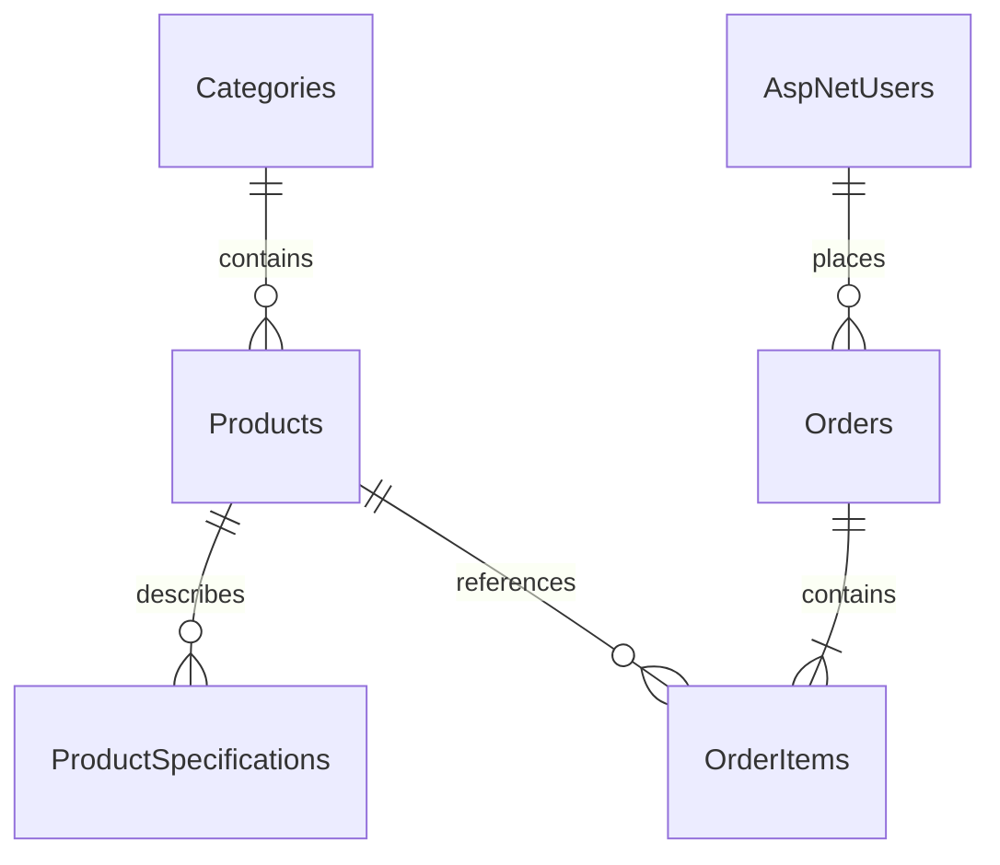

# Kiến trúc SmartMobile

## Luồng xử lý

`Trình duyệt → Controller/ViewModel → Service → StoreDbContext → SQL Server → Razor View`

- **Controllers** nhận HTTP, kiểm tra input, quyền và lựa chọn View. Các POST có antiforgery toàn cục.
- **ViewModels** giới hạn dữ liệu người dùng được gửi. Không bind nguyên entity Order/Product từ request.
- **Services** gồm giỏ session, đặt hàng, lưu ảnh. Controller không nhận giá/tổng tiền từ client làm dữ liệu chuẩn.
- **Data/StoreDbContext** ánh xạ entity, khóa ngoại, unique index, decimal và ràng buộc SQL. Identity dùng chung database.
- **Views** Razor tự encode dữ liệu; **wwwroot** giữ CSS và ảnh gốc. Khu vực Admin có `[Authorize(Roles = "Admin")]` trên từng controller.

Không thêm repository abstraction, microservice hoặc frontend framework cho bài tập này.

## Quan hệ dữ liệu

`ContactMessages` độc lập. Identity có các bảng tài khoản, vai trò, user-role, claim, login, token. Danh mục, SKU, slug và khóa submit có unique index; danh mục không cascade-delete sản phẩm. Dòng đơn lưu tên, SKU, đơn giá tại lúc mua để lịch sử không phụ thuộc giá hiện tại.

## Đặt hàng và tính đồng thời

Giỏ lưu danh sách `(ProductId, Quantity)` ở session server, không lưu giá chuẩn. Checkout có khóa GUID trong session. Backend tìm đơn cùng khóa/người mua để trả lại đơn cũ; unique index là lớp bảo vệ cuối.

`OrderService.PlaceAsync` mở transaction Serializable, đọc sản phẩm theo thứ tự ID, kiểm tra đang bán/tồn kho, tính tiền decimal, trừ kho và lưu đơn. Rowversion phát hiện cập nhật đồng thời. Nếu thiếu hàng hoặc lưu lỗi, transaction rollback. Deadlock hoặc xung đột được thông báo để người dùng kiểm tra đơn trước khi thử lại; không tự retry mù.

`TransitionAsync` chỉ cho phép Pending → Confirmed → Shipping → Completed; Pending/Confirmed được Cancelled. Chuyển Cancelled hoàn kho trong transaction; gọi lần hai bị từ chối. Admin sửa sản phẩm gửi rowversion cũ để tránh vô tình ghi đè tồn kho sau khi có người đặt hàng.

## Auth, ảnh và cấu hình

Identity hash mật khẩu; cookie HttpOnly/SameSite Lax, Secure khi dùng HTTPS. Form đăng ký không nhận vai trò admin. ReturnUrl đăng nhập chỉ chấp nhận đường dẫn nội bộ. User xem đơn luôn được lọc theo UserId từ cookie.

Upload kiểm tra độ lớn, đuôi, giải mã JPEG/PNG bằng Windows, giới hạn số điểm ảnh và ghi lại bitmap với tên ngẫu nhiên; không dùng tên/đường dẫn từ client. SVG chỉ là asset gốc, không được upload. Ảnh cũ được giữ, không tự xóa.

Không chạy migration trong startup. Script khởi tạo và test có cờ duyệt, database cố định và kiểm tra trùng tên. Secrets có thể được cấp qua môi trường; không log mật khẩu hoặc bật EF SensitiveDataLogging. Error page không trả stack trace/connection string.

Giới hạn: giỏ trong RAM, một máy localhost Windows, không có payment/email thật, chưa có cấu hình triển khai Internet hoặc hệ thống chống spam phân tán.
